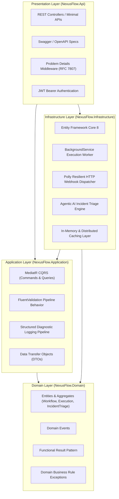

# NexusFlow ⚡

[](https://dotnet.microsoft.com/)
[](https://docs.microsoft.com/en-us/dotnet/csharp/)
[]()
[]()
[]()
[](https://www.docker.com/)
[](LICENSE)

> **Enterprise Resilient Workflow & Agentic AI Automation Engine** built with .NET 8, Clean Architecture, CQRS (MediatR), Polly HTTP Resilience, EF Core, and automated incident triage.

Designed and engineered by **[Syed Mustaq Ahamed](https://github.com/RealSyedMustaqAhamed)** (4+ Years Software Development Engineer across TCS & Infosys).

---

## 🏛️ Architecture Overview

NexusFlow implements **Clean Architecture (Onion / Hexagonal)** to ensure strict separation of concerns, testability, and enterprise maintainability:



---

## 🚀 Key Architectural Capabilities

### 1. Clean Architecture & CQRS with MediatR
- **Domain Layer (`NexusFlow.Domain`)**: Free of any third-party framework dependencies. Encapsulates business invariants, domain events, entities (`WorkflowDefinition`, `WorkflowExecution`, `WorkflowStep`, `IncidentTriage`), and the functional `Result<T>` pattern.
- **Application Layer (`NexusFlow.Application`)**: Orchestrates business use cases using MediatR CQRS commands and queries. Features automatic pre-handler validation via `FluentValidation` pipeline behaviors and duration telemetry logging.
- **Infrastructure Layer (`NexusFlow.Infrastructure`)**: Handles EF Core persistence, repository implementations, resilient HTTP webhooks with Polly, caching, and an asynchronous `BackgroundService` queue worker.
- **API Layer (`NexusFlow.Api`)**: Exposes RESTful endpoints, JWT security, health checks (`/health`), and RFC 7807 Problem Details error formatting.

### 2. Event-Driven Background Worker
- Asynchronous `BackgroundService` continuously monitors pending execution queues, steps through tasks in sequential order, executes telemetry checks, and records execution status updates without blocking HTTP threads.

### 3. Agentic AI Incident Triage Engine
- Automatically parses incident descriptions, application stack traces, and error logs to extract root causes, compute confidence scores, classify severity (Low, Medium, High, Critical), and recommend targeted remediation actions.

### 4. HTTP Resilience with Polly
- Outgoing webhooks are governed by standard resilience pipelines:
  - **Exponential Backoff with Jitter** (prevents retry storms).
  - **Circuit Breaker** (protects failing downstream services).
  - **Attempt Timeouts** (ensures thread pools remain healthy).

### 5. Production Observability & Error Handling
- Global exception handling middleware returns standard RFC 7807 `application/problem+json` envelopes.
- Health check endpoint `/health` for Kubernetes / container readiness probes.

---

## 📂 Project Structure

```
NexusFlow/
├── .github/
│   └── workflows/
│       └── ci.yml                     # GitHub Actions CI pipeline
├── src/
│   ├── NexusFlow.Domain/              # Pure domain models, events, invariants
│   │   ├── Common/                    # BaseEntity, Result<T>, IDomainEvent
│   │   ├── Entities/                  # WorkflowDefinition, Execution, Triage
│   │   ├── Enums/                     # StepType, ExecutionStatus, Severity
│   │   ├── Events/                    # Domain event contracts
│   │   └── Repositories/              # Repository interfaces & IUnitOfWork
│   ├── NexusFlow.Application/         # CQRS business use cases & validation
│   │   ├── Common/                    # Pipeline behaviors (Validation, Logging)
│   │   ├── DTOs/                      # Data contracts
│   │   ├── Incidents/                 # Triage commands & queries
│   │   └── Workflows/                 # Workflow commands & queries
│   ├── NexusFlow.Infrastructure/      # External concerns & data access
│   │   ├── BackgroundJobs/            # BackgroundService execution runner
│   │   ├── Persistence/               # EF Core DbContext & Repositories
│   │   └── Services/                  # Polly Webhook Dispatcher & AI Agent
│   └── NexusFlow.Api/                 # ASP.NET Core presentation layer
│       ├── Controllers/               # RESTful API Controllers
│       ├── Middleware/                # RFC 7807 Exception handling
│       └── Program.cs                 # Dependency injection & pipeline setup
├── tests/
│   └── NexusFlow.Tests/               # xUnit, FluentAssertions, Moq unit tests
├── Dockerfile                         # Multi-stage production container build
├── docker-compose.yml                 # Local container orchestration
└── README.md
```

---

## 🛠️ Getting Started

### Prerequisites
- [.NET 8 SDK](https://dotnet.microsoft.com/download/dotnet/8.0)
- [Docker](https://www.docker.com/) (Optional, for containerized run)

### Local Setup

1. **Clone the repository**:
   ```bash
   git clone https://github.com/RealSyedMustaqAhamed/NexusFlow.git
   cd NexusFlow
   ```

2. **Restore dependencies**:
   ```bash
   dotnet restore NexusFlow.sln
   ```

3. **Build the solution**:
   ```bash
   dotnet build NexusFlow.sln
   ```

4. **Run Unit Tests**:
   ```bash
   dotnet test NexusFlow.sln
   ```

5. **Start the API**:
   ```bash
   dotnet run --project src/NexusFlow.Api
   ```
   Navigate to `http://localhost:5000` or `https://localhost:5001` to view the interactive **Swagger UI**.

---

## 🐳 Docker Deployment

Run the entire service in an isolated Docker container with one command:

```bash
docker-compose up --build -d
```

The service will be live at `http://localhost:5000`.

---

## 📡 API Reference & Endpoints

| Method | Endpoint | Description | Auth Required |
| :--- | :--- | :--- | :---: |
| `POST` | `/api/v1/auth/token` | Generates a JWT Bearer token for API authentication | No |
| `GET` | `/api/v1/workflows` | Retrieves all active workflow definitions (cached) | No |
| `GET` | `/api/v1/workflows/{id}` | Retrieves workflow details and configured steps | No |
| `POST` | `/api/v1/workflows` | Creates a new workflow with custom steps | **Yes** |
| `POST` | `/api/v1/workflows/{id}/trigger` | Triggers a workflow execution asynchronously | No |
| `GET` | `/api/v1/executions/{id}` | Polls execution status and step execution timeline | No |
| `POST` | `/api/v1/incidents/triage` | Analyzes incident logs with Agentic AI triage | No |
| `GET` | `/api/v1/incidents/recent` | Retrieves recent AI incident triages | No |
| `GET` | `/health` | Health check probe for container readiness | No |

---

## 🧪 Automated Testing Suite

The solution includes an extensive suite of automated tests across Domain, Application, and Infrastructure layers using **xUnit**, **FluentAssertions**, and **Moq**:

```bash
Passed!  - Failed: 0, Passed: 17, Skipped: 0, Total: 17, Duration: 814 ms - NexusFlow.Tests.dll (net8.0)
```

- **Domain Tests**: Business invariants, step validation, state transitions, domain event emissions.
- **CQRS Handler Tests**: Command pipeline execution, repository mock verification, unit of work commit assertions.
- **AI Triage Tests**: Heuristic classification, confidence threshold evaluation, and severity categorization.

---

## 👨‍💻 Author & Profile

**Syed Mustaq Ahamed**
- **Experience**: 4+ years across Tata Consultancy Services (TCS) and Infosys.
- **Specialization**: Enterprise C#, ASP.NET Core, React.js, TypeScript, Resilient Backend Systems & Automation.
- **Achievements**: InStep Bizhacks AI Hackathon Finalist (Presented to Infosys founder N.R. Narayana Murthy).
- **LinkedIn**: [linkedin.com/in/syed-mustaq-ahamed](https://www.linkedin.com/in/syed-mustaq-ahamed)
- **GitHub**: [github.com/RealSyedMustaqAhamed](https://github.com/RealSyedMustaqAhamed)

---

## 📄 License
This project is licensed under the MIT License - see the [LICENSE](LICENSE) file for details.
